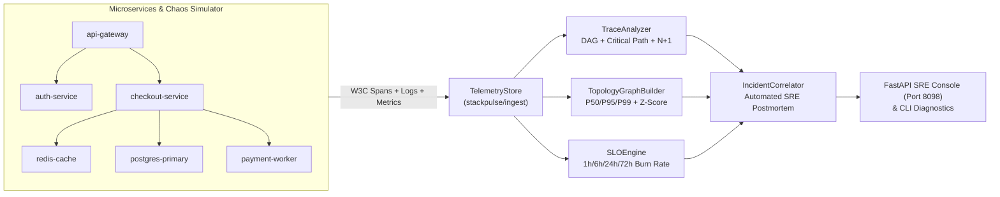

# StackPulse

[](https://github.com/codesphere-u/stackpulse/actions/workflows/ci.yml)
[](LICENSE)
[](pyproject.toml)
[](docs/architecture.md)

**StackPulse** is an OpenTelemetry-compatible **Cloud Observability, Distributed Trace Critical-Path Analyzer & Multi-Window SLO Reliability Platform**. It reconstructs flat W3C TraceContext spans into full parent-child DAG execution waterfalls, isolates exclusive critical-path latency bottlenecks, automatically detects **N+1 ORM query regressions** and **cascading retry storms**, computes **Google SRE Workbook multi-window error-budget burn rates (1h / 6h / 24h / 72h)**, and correlates anomalous traces, logs, and SLO breaches into an automated **Blameless SRE Postmortem**.

---

## Key Capabilities

1. **W3C TraceContext DAG Reconstruction & Critical-Path Bottleneck Engine (`stackpulse/tracing/analyzer.py`)**
   - Reconstructs parent-child span trees from flat, out-of-order OpenTelemetry spans.
   - Merges overlapping asynchronous child intervals to compute exact **exclusive span duration** ($D_{\text{excl}} = D_{\text{span}} - |\bigcup_i [t_{\text{start},i}, t_{\text{end},i}]|$) so parallel fan-out is never double-counted.
   - Automatically flags **N+1 ORM Query Regressions** ($\ge 4$ identical sequential database operations under a single parent span) and **Downstream Retry Storms**.

2. **Live Service Dependency Topology & Statistical Anomaly Detector (`stackpulse/topology/graph.py`)**
   - Builds a directed caller $\rightarrow$ callee microservice topology graph with golden signals (**RPS**, **Error %**, **P50 / P95 / P99 latency**, and **z-score latency spike detection**).

3. **Google SRE Workbook Multi-Window, Multi-Burn-Rate SLO Engine (`stackpulse/slo/engine.py`)**
   - Evaluates **Availability** and **Latency** SLIs across rolling compliance windows.
   - Computes `1h`, `6h`, `24h`, and `72h` error-budget burn rates (`14.4x` fast-burn `PAGE_CRITICAL` vs `6.0x` / `3.0x` `TICKET_WARNING`) and projects **Time-to-Exhaustion (hours)**.

4. **Automated Incident Timeline Correlator & Blameless SRE Postmortem Generator (`stackpulse/incidents/correlator.py`)**
   - Correlates trace critical-path bottlenecks, `ERROR`/`WARN` structured logs, and SLO burn alerts into a unified UTC timeline and exports a ready-to-share Markdown SRE Postmortem with targeted remediation action items.

5. **Interactive Dark-Mode SRE Console & Chaos Workload Simulator (`stackpulse/server/app.py` & `stackpulse/simulator/chaos.py`)**
   - Built-in deterministic microservice simulator (`api-gateway` $\rightarrow$ `auth-service` $\rightarrow$ `checkout-service` $\rightarrow$ `redis-cache` / `postgres-primary` / `payment-worker`) with 4 injectable failure modes:
     - `normal`: Low-latency baseline traffic
     - `db-saturation`: Connection pool exhaustion & `FOR UPDATE` row-lock cascade
     - `n-plus-one`: ORM lazy-loading N+1 query regression
     - `retry-storm`: Downstream payment gateway HTTP 503 retry amplification

---

## System Architecture



---

## Quick Start

### 1. Run via `uv` (Zero Setup)

```bash
# Run the full mixed chaos simulation and generate an SRE Postmortem in the terminal
uv run stackpulse simulate --scenario all --count 24

# Simulate a specific failure mode (db-saturation | n-plus-one | retry-storm | normal)
uv run stackpulse simulate --scenario n-plus-one --count 16

# Run the ingestion and DAG reconstruction throughput benchmark
uv run stackpulse benchmark --traces 500

# Launch the interactive dark-mode StackPulse Observability Console on http://127.0.0.1:8098
uv run stackpulse serve --host 127.0.0.1 --port 8098
```

### 2. Run via Docker Compose

```bash
docker compose up --build
# Open http://localhost:8098 for the interactive StackPulse Observability Console
```

---

## REST API Reference

| Method | Endpoint | Description |
|---|---|---|
| `GET` | `/` | Interactive Dark-Mode **StackPulse Observability & SRE Console** |
| `GET` | `/api/v1/health` | Platform health check & active telemetry buffer counts |
| `POST` | `/api/v1/ingest/spans` | Batch-ingest W3C TraceContext OpenTelemetry spans |
| `POST` | `/api/v1/ingest/logs` | Batch-ingest trace-correlated structured log records |
| `POST` | `/api/v1/ingest/metrics` | Batch-ingest counter, gauge, and histogram metric points |
| `GET` | `/api/v1/traces` | List reconstructed traces with bottleneck & anti-pattern badges |
| `GET` | `/api/v1/traces/{trace_id}` | Full hierarchical span waterfall, critical path & correlated logs |
| `GET` | `/api/v1/topology` | Directed service dependency graph with P50/P95/P99 & error rates |
| `GET` | `/api/v1/slo` | Multi-window (`1h`/`6h`/`24h`/`72h`) SLO burn-rate reports |
| `GET` | `/api/v1/incidents/postmortem` | Correlated incident timeline & Markdown Blameless SRE Postmortem |
| `POST` | `/api/v1/simulate` | Inject synthetic chaos scenario (`normal`, `db-saturation`, `n-plus-one`, `retry-storm`, `all`) |

---

## Verification & Testing

```bash
uv run --with pytest --with fastapi --with httpx --with pydantic --with uvicorn pytest -v
```

---

## Documentation Index

- [Architecture & Dataflow](docs/architecture.md)
- [ADR-001: OpenTelemetry DAG Critical-Path & Multi-Window SLO Math](docs/decisions/001-opentelemetry-dag-and-multi-window-slo.md)
- [Testing & Verification Guide](docs/testing.md)
- [Deployment & Docker Guide](docs/deployment.md)
- [Known Limitations & Production Roadmap](docs/limitations.md)

## License

Licensed under the [Apache License, Version 2.0](LICENSE).
